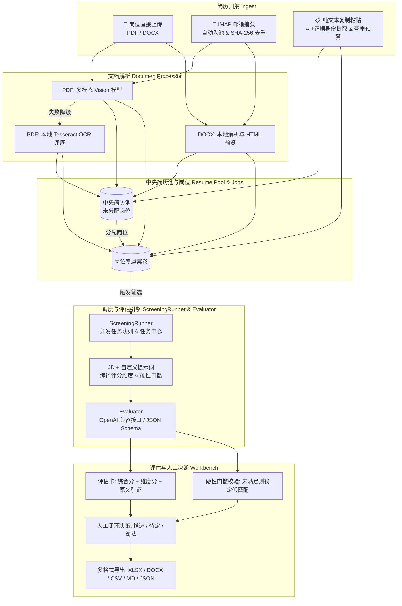

# HireFlow

<p align="center">
  <strong>本地优先的 AI 招聘简历智能筛选与人才库管理工作台</strong>
</p>

<p align="center">
  
  
  
  
  
  
</p>

---

HireFlow 是一个专为招聘人员（HR / 猎头 / 技术招聘主管）打造的**本地优先（Local-First）** AI 简历筛选与人才档案工作台。

招聘人员仅需配置岗位 JD 与自定义筛选要求，批量导入候选人简历，系统即可按照统一标准生成**包含原文证据引述（Evidence-Backed）**的结构化评估卡，并自动识别硬性门槛。所有简历文件与评估数据完全保留在本地，推进、待定或淘汰状态始终由招聘人员把控，拒绝黑盒打分。

---

## 🌟 核心特性

### 1. 全渠道简历归集与资产沉淀
- **📁 岗位直传**：支持批量上传 PDF 与 DOCX 简历附件，自动校验格式与页数。
- **📧 邮箱自动入池**：配置 IMAP 即可周期性自动监听拉取收件箱中的简历附件，先入「简历池」，支持基于 SHA-256 的全库智能去重；亦支持手动触发即时同步。
- **📋 文本一键粘贴**：支持从招聘网站、微信或邮件直接复制简历纯文本秒级录入。
- **🔍 结构化身份识别与查重预警**：后台异步自动提取姓名、邮箱、手机号（大模型结构化提取 + 手机号/邮箱正则兜底）。录入或粘贴时命中疑似重复候选人即刻弹出预警。

### 2. 双轨文档解析与多模态视觉处理
- **PDF 智能解析**：优先调度多模态 Vision 模型（如 `deepseek-v4-flash`、`gpt-4o-mini`）提取复杂版面与图片简历；视觉解析不可用或失败时，自动平滑降级至本地 Tesseract OCR（中英文支持）。
- **DOCX 本地极速提取**：基于本地安全解析器提取正文，并清洗生成高保真 HTML 预览。
- **原文校对与版本留痕**：支持在界面中直接在线校对并编辑解析文本，修正记录留痕；支持确认后一键从原件重新解析。

### 3. 维度化评分、硬性门槛与证据卡
- **智能编译评分维度**：自动结合岗位 JD 与自定筛选提示词，编译出包含分值（0~100）、权重、硬性项（Knockout）与加分项的评估矩阵。
- **硬性淘汰门槛拦截**：如学历、关键技术年限、必备证书等硬性要求，一旦标记为「未满足」，候选人综合匹配等级即刻锁定为「低匹配」并标红警示，避免粗心误推。
- **有据可查的原文引述**：评估卡逐项展示判断理由及简历中的**精确原文引述（Quotes）**，彻底打破 AI 打分黑盒。
- **模型格式通用兼容**：采用标准 OpenAI API 格式交互，原生适配 DeepSeek、OpenAI、Ollama 本地大模型及各类企业私有模型网关。

### 4. 中央简历池与全流程工作台
- **全局人才资产库**：未分配岗位的简历集中纳管，支持按年龄、性别、评估分数、评估状态、曾投岗位等多维度本地高速筛选。
  > *注：为恪守公平招聘原则，候选人性别与年龄仅在简历明确注明时提取用于档案分类筛选，绝不参与任何评分维度算法。*
- **灵活流转**：同一简历支持跨多个岗位分别评估，各岗位打分历史独立留存，简历池动态展示最新评估摘要。
- **批量与安全保障**：
  - 支持跨页多选、批量分配岗位、批量重评、批量人工审核与状态变更。
  - **全局回收站机制**：岗位与简历删除后进入 30 天保护期，可随时一键恢复，到期自动物理销毁。

### 5. 稳健的并发任务调度
- 隔离并发调度引擎（`ScreeningRunner`），单批次支持自定义并发（默认 5 并发），任务互不阻塞。
- 完善的「任务中心」：支持实时进度展示、异常断点重试与任务取消，单份解析或评分异常绝不阻塞批次运行。

### 6. 多格式数据报表一键导出
- 筛选结果支持跨页勾选指定候选人或全量导出为 **Excel (.xlsx)**、**Word (.docx)**、**CSV**、**Markdown** 以及 **JSON** 格式，方便向业务部门主管与面试官汇报流转。

---

## 🏗️ 架构与数据流转



---

## 🚀 快速上手

### 方式一：Docker Compose 一键运行（推荐，生产就绪）

Docker Compose 预配置了应用服务与 PostgreSQL 17 数据库，并内置了中英文 Tesseract OCR 运行环境：

```bash
# 1. 复制配置文件
cp .env.example .env

# 2. 编辑 .env 配置：填入 OPENAI_API_KEY、ADMIN_PASSWORD、SESSION_SECRET
# 如使用 DeepSeek，配置 OPENAI_BASE_URL=https://api.deepseek.com
vim .env

# 3. 启动应用
docker compose up -d --build
```

- 启动后浏览器访问：**`http://127.0.0.1:27183`**，首次打开需用管理员账号登录。
- 首次构建会下载 OCR 模型包，预计耗时 2~3 分钟。
- 默认宿主机端口为非常用端口 `27183`；若被占用，修改 `.env` 中的 `APP_PORT` 即可映射至其他端口。

**启停与数据管理**：
```bash
# 停止运行（数据完全保留）
docker compose down

# 查看实时日志
docker compose logs -f app
```
> **注意**：岗位、筛选历史与简历原件均保存在本地数据卷与 `data/` 目录中。只有显式执行 `docker compose down -v` 才会重置 PostgreSQL 数据库卷。

---

### 方式二：本地源码开发调试

#### 1. 前置依赖
- Python ≥ 3.11
- Node.js ≥ 18
- 本地可选安装 Tesseract OCR（用于无视觉模型时的本地 OCR 兜底）

#### 2. 后端启动（FastAPI + SQLite）
本地开发默认使用轻量级 SQLite，无需单独搭建数据库：

```bash
# 创建并激活虚拟环境
python3 -m venv .venv
source .venv/bin/activate

# 安装依赖（含开发与测试包）
pip install -e '.[dev]'

# 启动后端开发服务（开启热重载）
DATABASE_URL=sqlite:///data/hireflow.db DATA_DIR=data uvicorn app.main:app --reload --port 8000
```

#### 3. 前端启动（React + Vite）
```bash
cd frontend
npm install
npm run dev
```
开发服务器将运行在 `http://127.0.0.1:5173`，并通过 Vite 代理将 `/api` 请求转发至 `127.0.0.1:8000`。

---

## ⚙️ 环境变量配置说明

在项目根目录的 `.env` 中配置运行参数：

| 配置项 | 默认值 / 示例 | 说明 |
|---|---|---|
| **`OPENAI_API_KEY`** | `sk-...` | **必填**。用于调用评估与解析模型的 API Key |
| **`OPENAI_BASE_URL`** | `https://api.deepseek.com` | OpenAI 兼容接口地址。默认官方接口；使用 DeepSeek 或内网代理时填写 |
| **`TEXT_MODEL`** | `deepseek-v4-flash` / `gpt-4o-mini` | 用于评估与维度打分的文本推理模型 |
| **`VISION_MODEL`** | `deepseek-v4-flash` / `gpt-4o-mini` | 用于 PDF 多模态视觉解析的模型 |
| **`VISION_ENABLED`** | `true` | 是否优先启用 Vision 模型解析 PDF（设为 `false` 则直接使用本地 OCR） |
| **`MAX_CONCURRENCY`** | `5` | 后台并发评估简历的最大协程数 |
| **`MAX_FILE_MB`** | `20` | 单份简历文件最大允许体积（MB） |
| **`MAX_PDF_PAGES`** | `50` | 单份 PDF 最大允许解析页数 |
| **`MAX_RESUMES_PER_JOB`** | `200` | 单个岗位允许归档的简历数量上限 |
| **`MODEL_TIMEOUT_SECONDS`**| `120` | 模型单次交互调用超时时间（秒） |
| **`MODEL_MAX_RETRIES`** | `2` | 模型调用偶发失败时的最大重试次数 |
| **`APP_PORT`** | `27183` | Docker 暴露的 HTTP 访问端口 |
| **`ADMIN_USERNAME`** | `admin` | 管理员登录用户名 |
| **`ADMIN_PASSWORD`** | *必填* | 管理员登录密码（留空应用拒绝启动） |
| **`SESSION_SECRET`** | *必填* | 会话 Cookie 签名密钥（留空应用拒绝启动） |
| **`IMAP_HOST`** | *选填*，如 `imap.feishu.cn` | 招聘接收邮箱的 IMAP 服务器地址 |
| **`IMAP_PORT`** | `993` | IMAP 端口（通常 SSL 为 993） |
| **`IMAP_USER`** | *选填*，如 `hr@example.com` | 邮箱账号 |
| **`IMAP_PASSWORD`** | *选填* | 邮箱密码或专有应用授权码 |
| **`IMAP_POLL_SECONDS`** | `300` | 邮箱自动拉取扫描间隔周期（秒） |

---

## 🧪 自动化测试与工程验证

HireFlow 拥有高覆盖率的自动化测试套件（严格遵循 Fake Evaluator 规范，测试不消耗实际 Token）：

```bash
# 运行后端所有单元测试与 API 测试（88+ 测试用例）
.venv/bin/pytest -q backend/tests

# 运行前端测试（Vitest + Testing Library）
cd frontend && npm test

# 前端静态检查与生产构建
npm run build

# 验证 Docker Compose 语法配置
docker compose config
```

---

## 🔒 隐私、合规与数据伦理

1. **不可信输入防护**：简历内容属于不可信输入。解析阶段严格清洗，并在评估提示词中进行严格的系统边界隔离，严禁向模型注入 shell、网络检索或文件修改权限。
2. **本地落盘**：候选人原始文件与解析内容仅存储在本地宿主机或内网挂载卷中，不向任何第三方服务持久化同步。
3. **数据最小化与防偏见原则**：
   - 邮箱同步机制（`mail_ingest.py`）仅记录同步计数与附件，严格不记录或输出邮件正文。
   - 提取的候选人性别与年龄仅用于库内归档分类，**严格不进入评分逻辑和打分权重**，系统保障评价以能力与技能经验为基准。

---

## 📄 开源协议

本项目基于 [MIT License](LICENSE) 开源发布。
